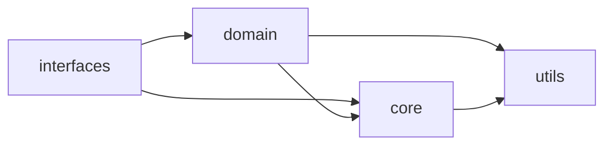

# app

Codigo-fonte principal do SpeechChecker.

## Responsabilidade

Esta pasta contem o pacote Python da aplicacao: nucleo transversal, dominio,
adaptadores de entrada, utilitarios compartilhados e pontos de composicao.

## Quando usar

Use esta arvore para evoluir regras de negocio, pipelines de inferencia,
treinamento, extracao de features, UI Gradio, API FastAPI e CLI. Dados de usuario,
datasets, caches, modelos e resultados ficam em `data/`, nunca dentro do pacote.

## Dependencias internas

## Pastas

- `core/`: configuracao, contratos, seguranca, middleware, DB e infraestrutura transversal.
- `domain/`: regras de negocio, modelos, features, servicos e XAI.
- `interfaces/`: adaptadores de entrada Gradio, FastAPI e CLI.
- `utils/`: utilitarios puros e compartilhados.
- `dependencies.py` e `deploy_hf.py`: composicao compartilhada entre interfaces.
- `file_storage.py`: persistencia compartilhada de arquivos.

## Regras

- `domain/` nao deve importar `interfaces/`.
- Contratos ficam em `app.core.contracts`; o alias legado `app.core.interfaces` foi removido. Nenhum `__init__.py` re-exporta nomes: importe do submodulo.
- Dados persistidos de perfis de voz ficam em `data/voice_profiles/`.
- Novas capacidades devem nascer no dominio ou em um adaptador explicito, nao como utilitario global por conveniencia.
