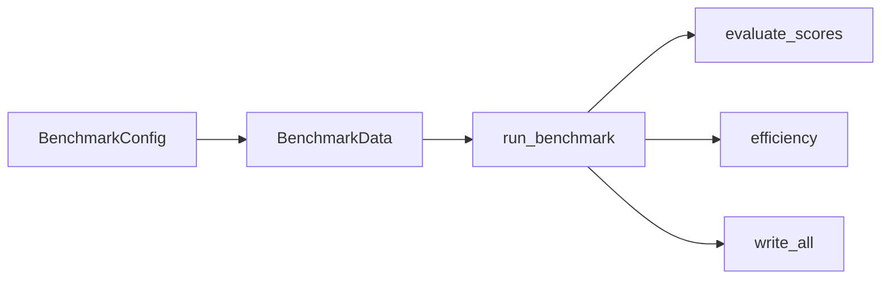

# benchmarks

Harness de benchmark e avaliacao experimental do SpeechChecker.

## Responsabilidade

Orquestra execucoes reprodutiveis de treino, avaliacao, robustez, eficiencia e
geracao de relatorios para o recorte experimental do TCC.

## Referência canônica do artigo

Para reproduzir o estudo do TCC, use `run_models_sequential.py` com o NPZ e o
test lock de 15 mil amostras, conforme
[`docs/evaluation/canonical-study-and-legacy-inventory.md`](../docs/evaluation/canonical-study-and-legacy-inventory.md).
O `run_tcc_pipeline.py` é um fluxo genérico legado baseado em tiers e não
reconstrói por si só o recorte CETUC–Fake Voices/XTTS-v2 nem as partições do
artigo. Os runners antigos permanecem disponíveis para reproduzir estudos
históricos e não devem ser confundidos com a receita do artigo.

## Quando usar

Use quando precisar executar ou planejar benchmarks por arquitetura, gerar
artefatos em `data/results/`, validar robustez com AWGN ou produzir tabelas/figuras
para documentacao cientifica.

## Dependencias

- `app.domain.models.architectures` para construir modelos.
- `app.domain.features.benchmark_frontend` para manter paridade treino/inferencia.
- `sklearn`, `numpy`, `matplotlib` e, para modelos neurais, TensorFlow/Keras.

## Arquivos

- `__init__.py`: API publica do pacote (`BenchmarkConfig`, `run_benchmark`,
  `plan_benchmark` e constantes oficiais).
- `config.py`: presets, manifesto oficial do TCC e listas de arquiteturas.
- `data.py`: carregamento, validacao, split e preparo de dados.
- `evaluate.py`: metricas de deteccao, incluindo AUC, EER e min-tDCF.
- `efficiency.py`: parametros, tamanho em disco e latencia.
- `planning.py`: plano de execucao e hiperparametros por arquitetura.
- `runner.py`: orquestracao ponta a ponta do benchmark.
- `protocol.py`: particoes preparadas (AWGN na forma de onda), politica de
  banda e carimbos do `input_contract`.
- `fit_neural.py`, `fit_classical.py`: treino das neurais (via
  `TrainingService`) e de SVM/RandomForest (grid, CV agrupada, calibracao).
- `split_audit.py`: sobreposicao, impressoes digitais e atalho fonte-rotulo.
- `provenance.py`: commit, bibliotecas, checkpoints e manifesto do run.
- `seed_aggregation.py`: media e desvio entre repeticoes por semente.
- `common.py`: defaults de ambiente, nomes, caminhos e artefato do run.
- `report.py`: artefatos JSON/CSV/Markdown/LaTeX/figuras.
- `api_probe.py`: verificacao de endpoints da API durante benchmarks.

## Entry points

Os comandos operacionais foram centralizados nesta pasta junto ao harness.
Execute-os a partir da raiz do repositório:

```bash
python benchmarks/run_benchmark.py --help
python benchmarks/run_models_sequential.py --help
python benchmarks/run_tcc_pipeline.py --help
```

| Entry point | Responsabilidade |
| --- | --- |
| `run_models_sequential.py` | Runner operacional para a bateria do artigo; coordena modelos, timeout e retomada. |
| `run_benchmark.py` | Executa e avalia modelos pelo harness; uso por modelo ou análises auxiliares. |
| `run_tcc_pipeline.py` | Pipeline genérico legado por tiers; não é equivalente ao protocolo do artigo. |
| `run_clean_benchmark_pipeline.py` | Orquestrador histórico de bateria; conferir seus defaults antes de uso. |
| `run_wavlm_original_benchmark.py` | Treina/avalia as cabeças dos backbones SSL originais. |
| `run_ast_ablation.py` / `run_rawgat_retune.py` | Executam estudos de ablação e retreino exploratório. |
| `benchmark_latency.py` / `latency_single_device.py` | Medem latência geral e latência comparável em CPU. |
| `robustness_test.py` | Mede robustez AWGN de uma arquitetura. |
| `eval_cross_generator.py` | Avalia artefatos em corpus de gerador externo, sem retreino. |
| `reexecutar_ssl_com_registro.sh` | Reexecuta os modelos SSL e registra os resultados. |

Os comandos de benchmark são executados a partir da raiz do repositório.

## Fluxo interno



## Nota arquitetural

Este pacote foi restaurado por compatibilidade porque scripts, testes e
notebooks importam `benchmarks.*` diretamente. A evolucao recomendada e manter a
API estavel enquanto se decide se o harness permanece como pacote de
experimentos ou migra para um modulo dedicado de avaliacao.

## Protocolo AWGN para o retreino

O benchmark comparável aplica AWGN na forma de onda, depois do split e antes do
frontend de cada arquitetura. O modo estrito rejeita datasets reais que
contenham somente features. O comando canônico e a lista de verificações estão
em docs/evaluation/retraining-adjustments.md.
