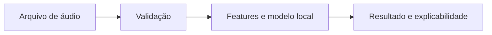

# SpeechChecker

Plataforma open source para análise de áudio e detecção de deepfakes, com
interface Gradio, API FastAPI e execução local. Esta documentação reúne os
guias de uso, desenvolvimento e reprodução do estudo acadêmico.

Na execução local, o áudio é analisado na máquina que hospeda a aplicação; não
há serviço SpeechChecker em nuvem. A instalação e alguns backbones podem baixar
dependências externas. Em um deploy remoto, o áudio é processado pelo servidor
escolhido para esse deploy.

> **Estado do estudo:** a proveniência dos resultados do artigo está em
> reconciliação. Métricas históricas não devem ser apresentadas como uma rodada
> confirmatória do protocolo canônico. Consulte o [inventário do estudo](evaluation/canonical-study-and-legacy-inventory.md)
> antes de usar resultados em apresentações ou publicações.

## Comece por aqui

=== "Quero usar a aplicação"

    1. Leia [Instalação e Configuração](getting-started/installation.md).
    2. Inicie a interface local com `python main.py --gradio`.
    3. Consulte os fluxos da [interface Gradio](interfaces/gradio.md).

=== "Quero contribuir"

    1. Entenda a [arquitetura](architecture/overview.md).
    2. Siga o [guia do desenvolvedor](development/developer-guide.md).
    3. Execute os [gates de qualidade](development/release-gates.md).

=== "Quero reproduzir o estudo/TCC"

    1. Leia o [estudo canônico e inventário de legado](evaluation/canonical-study-and-legacy-inventory.md).
    2. Confira a [auditoria de dataset e modelos](evaluation/model-dataset-artifact-audit.md).
    3. Siga o [benchmark e resultados](evaluation/benchmark.md) e o
       [protocolo do dataset](data/dataset-protocol.md).

## Referência do estudo

O artigo define o protocolo de referência. O NPZ local de 15.000 amostras e o
test lock não são distribuídos pelo Git. A documentação registra divergências
de proveniência entre artefatos e resultados locais; por isso, não trate os
resultados históricos como confirmados. A licença e as permissões de
redistribuição do corpus derivado também precisam ser confirmadas antes de
publicá-lo. Consulte a [auditoria dos artefatos](evaluation/model-dataset-artifact-audit.md)
para hashes, disponibilidade e pendências.

## Fluxo de análise



## Guias principais

| Objetivo | Referência |
| --- | --- |
| Entender detecção de áudio sintético e métricas | [Conceitos e fundamentos](getting-started/concepts.md) |
| Conhecer o projeto e seus limites | [Introdução](getting-started/introduction.md) |
| Instalar e executar localmente | [Instalação](getting-started/installation.md) |
| Entender a arquitetura e as features | [Arquitetura](architecture/overview.md) · [Features de áudio](architecture/audio-features.md) |
| Usar a API ou a interface | [API REST](interfaces/rest-api.md) · [Gradio](interfaces/gradio.md) |
| Consultar modelos e treinamento | [Arquiteturas](models/architectures.md) · [Treinamento](models/training.md) · [Inferência](models/inference.md) |
| Preparar dados | [Protocolo do dataset](data/dataset-protocol.md) · [Datasets públicos](data/public-datasets.md) |
| Publicar documentação ou aplicação | [GitHub Pages e Hugging Face](deployment/github-pages-and-hugging-face.md) · [Hugging Face Spaces](deployment/hugging-face-spaces.md) |
| Estudar exemplos executáveis | [Guia de notebooks](evaluation/notebooks.md) |
| Tirar dúvidas | [FAQ](reference/faq.md) · [Glossário](reference/glossary.md) |

## Estrutura do projeto

- `app/domain/`: regras de negócio, features, modelos e serviços.
- `app/core/`: configuração, contratos e infraestrutura compartilhada.
- `app/interfaces/`: entradas Gradio, CLI e API web.
- `benchmarks/`: runners e configuração do protocolo experimental.
- `docs/`: fonte editorial deste site; `infrastructure/site/` é uma saída gerada e ignorada pelo Git.
- `data/`: datasets, cache, modelos e resultados locais; artefatos grandes não são
  publicados pelo Git por padrão.
- `data/voice_profiles/`: armazenamento persistente dos perfis de voz, ao lado
  dos demais dados locais.
- A avaliação detalhada da árvore e das convenções está em
  [Auditoria e Organização](architecture/project-structure.md).

## Comandos rápidos

```bash
python main.py --bootstrap-dirs
python main.py --gradio
python -m pytest tests/unit/
mkdocs build --strict --clean
python tools/ops/check_docs_site.py infrastructure/site
```

Para instalar apenas as dependências de documentação, use
`python -m pip install -r requirements-docs.txt`. Para detalhes de instalação,
dependências de ML e comandos por sistema operacional, consulte o
[guia de instalação](getting-started/installation.md).
