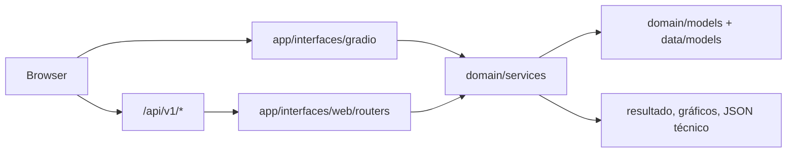

# 23 — Frontend Gradio e Fluxos de Análise

A interface Gradio é a superfície principal de demonstração do SpeechChecker. Ela é
montada no mesmo processo FastAPI que expõe a API REST, permitindo usar UI e
HTTP lado a lado.

## O assistente treina a MESMA arquitetura do benchmark (2026-08-21)

A aba de treino chamava `create_model_by_name(arch, input_shape, num_classes=2)`
— **sem hiperparâmetro nenhum**. O painel exibia os valores do plano, mas o
modelo saía com os defaults de `registry.default_params`.

Para o RawNet2 isso construía a arquitetura **errada**: o "Improved RawNet" de
verificação de locutor (~7,0M parâmetros) com o rótulo "RawNet2" que o TCC usa
para o baseline anti-spoofing de Tak et al. (~17,6M). O modelo salvo entrava em
`data/models/` indistinguível do outro.

O assistente agora resolve os parâmetros por
`planning.effective_hyperparameters()` — o mesmo caminho do benchmark — e os
repassa ao construtor. O **filtro é o `default_params` da própria arquitetura**,
não uma lista de exclusão: o plano mistura topologia, regime de treino e
metadado (`notes`, `model_family`), e vários `create_model` aceitam `**kwargs`,
onde uma chave estranha levanta `TypeError`. O registry declara exatamente o que
cada construtor aceita, então intersectar com ele dá o subconjunto correto — o
plano só sobrescreve o VALOR de chaves que já existem lá.

Verificado nas sete arquiteturas que a interface constrói; o RawNet2 passa a
sair com 17.623.778 parâmetros, os mesmos do benchmark.

## Como iniciar

```bash
python main.py --gradio
```

ou via Docker:

```bash
docker compose --env-file .env -f infrastructure/docker/compose/inference.cpu.yml up --build -d
```

A porta depende de como a aplicação subiu: 7862 no modo local, 7861 no Docker CPU e
7860 no Docker NVIDIA. Veja o
[mapa de portas](../development/docker-environments.md#portas). Os exemplos usam a local:

| Recurso | URL |
|---|---|
| Interface Gradio | `http://localhost:7862/gradio` |
| Entrada principal | `http://localhost:7862/` (redireciona para `/gradio/`) |
| Compatibilidade de inicialização | `/loading` (redireciona para a entrada principal) |
| Healthcheck | `http://localhost:7862/api/v1/system/health` |
| OpenAPI | `http://localhost:7862/api/docs` |

`app/interfaces/gradio/app.py` monta a única interface visual e carrega seu
tema de `app/interfaces/gradio/static/css/theme.css`. O módulo
`app/interfaces/web/main_fastapi.py` monta FastAPI, a API REST e a UI Gradio em
`/gradio`; a raiz redireciona para essa UI. Em modo API-only, a raiz leva à
documentação Swagger em `/api/docs`.

## Configurações Necessárias

Antes de abrir a interface, confirme:

| Item | Configuração recomendada |
|---|---|
| Modelos default | `data/models/benchmark_final/` e manifesto consolidado |
| Diretório de modelos | `DEEPFAKE_MODELS_DIR=data/models` |
| Porta | [Mapa de portas](../development/docker-environments.md#portas) |
| Host Docker/HF | `GRADIO_SERVER_NAME=0.0.0.0` |
| Ambiente demo | `DEEPFAKE_ENV=production` |
| Treino em demo pública | `ENABLE_TRAINING=false` |
| Sincronização HF | `MODEL_REPO_ID` + `XFAKE_SYNC_MODELS_ON_BOOT=true` |
| GPU | WSL2/Linux/Docker GPU ou Hugging Face GPU Space |
| Persistência | `XFAKE_STORAGE_DIR=/data` em Hugging Face Storage |

O healthcheck deve retornar `status=healthy` e `models_loaded` maior que zero
quando os modelos consolidados estão disponíveis.

## Comunicação com o Backend



Na UI, callbacks Gradio chamam serviços de domínio diretamente. Na API, routers
FastAPI chamam os mesmos serviços por dependências. O domínio permanece
independente de Gradio/FastAPI, e essa fronteira é protegida por testes de
integração.

## Estrutura da UI

O arquivo `app/interfaces/gradio/app.py` organiza a experiência em seis seções,
agrupadas pelo que a pessoa quer fazer e em ordem de uso:

| Seção | Arquivos principais | Papel |
|---|---|---|
| Painel | `tabs/dashboard.py` | estado do sistema, atividade recente e atalhos |
| Detectar | `tabs/detection.py`, `tabs/history.py` | um áudio, em lote e histórico |
| Investigar | `tabs/forensic_analysis.py`, `tabs/features.py` | análise forense, explicabilidade e características |
| Perfis de voz | `tabs/voice_profiles.py` | perfil, amostras, treino e verificação, nessa ordem |
| Treinar | `tabs/training_wizard.py`, `tabs/optimization.py` | assistente e otimização |
| Datasets | `tabs/dataset_management.py` | visão geral, download, preparo e compatibilidade |

A barra superior mostra o estado real (`Pronto` ou `Sem modelos`), o hardware em
uso, o número de modelos e perfis, o sino de notificações e o alternador de tema.
O sino abre um painel com avisos e erros destinados à pessoa usuária. O buffer
completo, com o espelho dos logs do processo, continua em
`/api/v1/system/feedback`.

Convenções da interface, para manter ao mudar uma tela:

- **Toda opção visível tem efeito.** Um controle sem ligação com o treino ou a
  inferência sai da tela, em vez de ficar "para depois".
- **Resultado só depois de haver resultado.** Gráficos e botões de exportar ficam
  ocultos até a análise terminar: figura vazia parece erro.
- **Ação destrutiva pede confirmação na própria tela** (`.confirm-row`).
- **Tema pela classe `.dark` do próprio Gradio.** Os tokens `--xf-*` e os componentes
  nativos mudam juntos. O padrão é escuro porque as figuras têm fundo escuro.
- **CSS só com classes estáveis** (`.block`, `.gr-group`, `.tab-wrapper`, `elem_classes`),
  nunca `svelte-*`, que muda a cada versão.
- **A tela de login é do Gradio:** ela não recebe o CSS nem o `head` da aplicação.

!!! note "Idioma"
    O alternador PT/EN foi **removido em 2026-07-28**: ele chamava
    `i18n.set_language()` mas nenhuma aba consumia `i18n.t()`, então a interface
    seguia inteiramente em português. O módulo `utils/i18n.py` permanece, com o
    dicionário de traduções. Ao reintroduzir, o idioma precisa viver em
    `gr.State` (por sessão) — a variável de módulo `_current_lang` é global do
    processo, e o Gradio serve várias sessões no mesmo processo.

## Aba Painel

Objetivo: visão rápida do estado do sistema.

| Bloco | Uso |
|---|---|
| KPIs | análises recentes, modelos carregados, perfis e datasets |
| Atalhos | ir direto para analisar, investigar ou treinar |
| Últimas análises | histórico resumido das predições |
| Estado do sistema | banco, modelos, GPU e Python |

Use esta aba para confirmar se o app subiu corretamente e se os modelos default
foram encontrados antes de executar uma análise.

## Aba Detectar

Objetivo: executar inferência em áudio individual, enviado ou gravado, ou em lote, e
consultar o histórico.

Fluxo recomendado:

1. Abra **Detectar → Um áudio**.
2. Envie um arquivo ou, na aba **Gravar**, grave e clique em **Parar**. Uma origem
   substitui a outra.
3. Escolha o modelo. A lista traz só os modelos instalados, e **Automático** usa o
   padrão do sistema.
4. Use **Analisar em janelas** para áudios longos.
5. Execute a análise.

A gravação é analisada inteira, depois de parar. Enquanto ela acontece, a tela mostra só
a forma de onda desenhada pelo navegador; o veredito e os gráficos vêm com a análise.

!!! warning "Gravações de microfone"
    Os modelos só viram voz do CETUC e clones do XTTS-v2, e o estudo não avaliou gravações
    de campo. Por isso, o cartão sempre avisa quando o áudio veio do microfone.

    Em 2026-11-03, uma voz real gravada no navegador dividiu os 9 modelos, com 5 votos em
    sintética e 4 em real. Em uma simulação com 100 vozes reais e 100 sintéticas da
    validação, a compressão Opus quase não mudou o resultado, mas aplicar o perfil de
    frequências dessa gravação baixou a detecção de voz sintética do AASIST de 98% para 48%
    e a do RawGAT-ST de 95% para 34%. Esses números vêm de uma gravação e de uma simulação,
    não de uma avaliação de campo.

Saídas:

| Saída | Descrição |
|---|---|
| Veredito | conclusão em texto, pontuação de voz sintética, modelo usado e avisos (gravação de microfone, fora do padrão de treino, pouca margem) |
| Pontuação de voz sintética | P(fake) reescalada para que 50% seja sempre o ponto de decisão do modelo: acima, sintética; abaixo, real |
| Confiança no veredito | distância da pontuação até o limite, de 50% a 100% |
| Gráficos do áudio | forma de onda, espectrograma Mel, energia RMS e pitch quando aplicável |
| Dados técnicos | modelo usado, P(fake) bruta, limiar calibrado, metadados e features |

!!! info "Por que a tela não mostra P(fake) direto"
    Cada modelo decide em `p_fake >= limiar`, e o limiar calibrado vai de 0,05 a 0,99. O
    mesmo número tinha significados opostos: P(fake) de 0,80 é "real" no AASIST (corte em
    0,94) e "sintética" no Conformer (corte em 0,48). A pontuação de
    `detection/operating_point.py` leva o limiar a 50% sem mudar nenhum veredito, e vale
    também para a análise forense, o lote, o histórico e a API.

    A pontuação não é uma probabilidade calibrada. Nas 200 amostras de validação de cada
    um dos 9 modelos, o acerto real ficou acima da confiança declarada em todas as faixas,
    salvo a mais alta (97,9% contra 98,7%). Perto do limite ele é baixo: nos 37 casos em que
    P(fake) e o veredito discordam, foi de 59,5%, e o cartão avisa quando a margem é pequena.

Para lote, envie múltiplos arquivos em **Em lote** e revise distribuição, tabela
por arquivo e relatório exportável, que aparecem depois da análise. Para benchmark científico, prefira
`benchmarks/run_tcc_pipeline.py` ou `benchmarks/run_benchmark.py`.

## Serving de Inferência

Caminho operacional:

```text
Gradio -> DetectionService -> ModelLoader -> FeaturePreparer -> Predictor
```

Pontos que precisam permanecer alinhados:

- `input_contract` salvo pelo treino contém `input_shape`, `type/format`,
  `sample_rate`, `temperature`, `eer_threshold`, `ood_threshold`,
  `scaler_applied` e `label_classes`.
- `FeaturePreparer` prioriza o contrato salvo antes de usar fallback de
  registry.
- `Predictor` aplica temperature scaling, EER threshold, energy score para OOD
  e MC Dropout quando solicitado.
- A carga Keras registra `custom_objects` para camadas customizadas e
  extratores SSL.
- O áudio é reamostrado para o `sample_rate` do contrato antes da extração.

### Correção P0 consolidada

O problema corrigido estava na descoberta de modelos: `ModelLoader` buscava
apenas artefatos não recursivos em `data/models/*.keras|*.pkl`. Como os modelos
finais ficam em `data/models/benchmark_final/<arch>/bench_<arch>.*`, a UI podia
cair em modelos de demonstração não treinados.

A descoberta agora inclui `benchmark_final/*/bench_*.{keras,h5,pkl,pt}` com
deduplicação por caminho real e filtro pelo prefixo `bench_`, evitando capturar
checkpoints intermediários. Na árvore atual, a verificação registra os 11
modelos finais do recorte oficial sincronizado com seus `_config.json`; as
demais arquiteturas continuam disponíveis no catálogo/harness quando houver
artefatos publicados.

Itens remanescentes para próxima rodada:

- Gravar receita completa de features no `input_contract` durante retreino,
  incluindo `feature_types`, `n_mels`, `n_fft`, `hop_length` e LFCC/CQT quando
  aplicável.
- Recalibrar `temperature` e `eer_threshold` em validação representativa com
  ruído após retreino.

Detalhes de ajustes de retreino ficam em [Retreino com Ajustes](../evaluation/retraining-adjustments.md).

## Aba Investigar

Objetivo: análise forense e explicabilidade além da classificação binária.

| Análise | Finalidade |
|---|---|
| Forma de onda | inspeção visual de amplitude, cortes e silêncio |
| Espectrograma | padrões espectrais e artefatos de síntese |
| Features acústicas | MFCC, LFCC, CQT, RMS, ZCR e métricas espectrais |
| Prosódia | energia, pitch e variações temporais |
| Qualidade vocal | jitter, shimmer, HNR e estabilidade |
| Metadados | duração, sample rate e informações técnicas |
| Explicabilidade | regiões/atributos que influenciam a decisão quando disponível |

Use esta aba para explicar por que uma amostra foi classificada como suspeita e
para gerar material visual de apoio à apresentação.

## Aba Perfis de voz

Objetivo: comparar um áudio com a voz de uma pessoa conhecida. As abas seguem a
ordem do fluxo: **1. Perfis**, **2. Amostras**, **3. Treinar** e **4. Verificar**.
Dados de contato são opcionais e ficam recolhidos. Excluir um perfil apaga amostras
e modelo, e por isso pede confirmação.

## Aba Treinar

Objetivo: criar ou atualizar modelos a partir de datasets organizados.

| Etapa | Descrição |
|---|---|
| Dados | pasta com uma subpasta por classe, validada antes de avançar |
| Modelo | arquitetura, com a comparação entre elas recolhida |
| Ajustes | épocas, lote, taxa de aprendizado e compensação de classes |
| Treinar | progresso, métricas e, ao terminar, avaliação e salvamento |

O treino interativo não calibra temperatura nem limiar EER, e não aplica SWA nem
mixup: esses recursos são do pipeline de benchmark, e as caixas que os prometiam nesta
tela saíram em 2026-11-02.

!!! tip "Feedback do treino (2026-07-29)"
    O painel ao vivo já trazia fase, época, ETA e cartões de métrica — o
    `model.fit` roda numa thread com fila de épocas e heartbeat de 1 s, então a
    interface não congela nem durante a primeira época. Três lacunas foram
    fechadas:

    - **Custo antes de começar.** Ao escolher arquitetura e épocas, o passo 3
      mostra a estimativa reaproveitando as horas medidas em
      `benchmarks.planning.EXPECTED_TRAINING_HOURS` — as mesmas que derivam o
      timeout do benchmark. Acima de 6 h o aviso sugere reduzir as épocas.
    - **Interromper.** O Keras não permite abortar no meio de uma época; o
      botão sinaliza e um callback marca `stop_training` no próximo limite de
      época, deixando o modelo em estado consistente.
    - **Sobreajuste ao vivo.** Quando a `val_loss` fica 5+ épocas sem melhorar,
      o painel avisa e lembra que o melhor checkpoint já está salvo — sem isso,
      interromper parece perder o trabalho.

!!! success "Os defaults são os do pipeline (2026-07-28)"
    Ao selecionar uma arquitetura, a interface propõe a **mesma configuração que
    o benchmark treina** — lote, taxa de aprendizado, dropout, otimizador,
    scheduler, augmentation, precisão mista e `pretrained`. Antes, `load_defaults`
    caía em literais próprios (`batch_size=32, epochs=10, learning_rate=0.001`)
    para toda arquitetura: AASIST, Conformer e Sonic Sleuth apareciam idênticas
    e nenhuma batia com o pipeline.

    A resolução é `benchmarks.planning.effective_hyperparameters()`, com
    precedência: piso operacional → linha `default` de `architecture_configs`
    (que traz a ESTRUTURA — `patch_size`, `embed_dim`, `num_blocks`…) → **plano
    do benchmark, que vence**. Essas linhas do banco são semeadas pela
    aplicação, não escritas pelo usuário, e já divergiam: a do
    SpectrogramTransformer trazia `pretrained=False`, fazendo a interface propor
    treinar do zero um modelo que o pipeline treina a partir dos pesos AudioSet.

    As cinco arquiteturas do escopo estendido (Sonic Sleuth, EfficientNet-LSTM,
    Ensemble, WavLM, HuBERT) não têm entrada de plano e seguem pelo
    `registry.default_params`.

Saídas esperadas:

- modelo salvo em `data/models/bench_<modelo>.*` ou na estrutura consolidada;
- config em `data/models/bench_<modelo>_config.json`;
- logs e métricas de treino;
- gráficos de convergência quando disponíveis;
- compatibilidade imediata com a aba **Detectar** e API.

Em deploy público ou apresentação, mantenha `ENABLE_TRAINING=false`. Para
treinamento real, prefira WSL2/Linux com GPU, Docker GPU ou Hugging Face GPU
Space com Storage.

## Aba Benchmark

Objetivo: ver o estudo do TCC (modelos, hiperparâmetros, calibração e resultados) e
reproduzir o artigo. O código fica em `tabs/benchmark.py`; as leituras e o lançador, em
`app/domain/services/benchmark/`.

| Sub-aba | O que mostra |
|---|---|
| Artigo | título, resumo e PDF de `data/results/paper`; protocolo; limitações; tabela de resultados do artigo; comparações pareadas |
| Modelos | cada modelo instalado: calibração que a detecção aplica, EER de validação e de teste, convergência, plano × treino |
| Hiperparâmetros | a receita de cada uma das 11 entradas no perfil de GPU, com o custo estimado e o medido |
| Resultados | qualquer run em `data/results`: tabela, EER com IC 95%, EER por condição de ruído, figuras do relatório |
| Executar o TCC | pré-condições, comando exato, iniciar, parar, retomar e consolidar |

**Atalhos.** Em Modelos, **🎯 Testar na detecção** abre Detectar → Um áudio com o modelo
escolhido. **🎓 Treinar esta arquitetura** abre o assistente com a arquitetura escolhida.
WavLM e HuBERT Original treinam pelo runner PyTorch e não têm esse atalho.

**Métricas de teste dos modelos instalados.** Vêm do run cujo
`model_artifact_fingerprint` bate com o sha256 do arquivo. O `registry.json` da
promoção pode descrever outro artefato e só vale quando o sha256 também bate.

**Executar o TCC.** O botão só habilita com:

- GPU visível ao TensorFlow;
- `XFAKE_ENABLE_BENCHMARK_RUN=1` no `.env`;
- login do Gradio ativo;
- NPZ e selo do teste conferidos;
- 20 GB livres;
- nenhum run em andamento;
- a confirmação de que o run leva cerca de 58 h de GPU.

Cada run grava em `data/results/tcc_reproducao_<data>`, e os modelos ficam em
`data/models/tcc_reproducao_<data>`. Nem os modelos da detecção nem o run vigente
são tocados. **Consolidar** grava em `<run>/consolidated`, nunca em
`data/results/paper`. Sem GPU (Windows nativo), a aba mostra o equivalente pelo
compose de benchmark, com a mesma pasta isolada (`docker compose ... run --rm -e
MODELS_DIR=...`). Esse run também é acompanhado pela aba, pela pasta.

## Aba Datasets

Objetivo: ver, baixar e preparar os dados.

| Área | Uso |
|---|---|
| Visão geral | contagens, distribuição, fontes e partições |
| Download | escolher tamanho e fontes, calcular o plano e baixar |
| Pré-processamento | limpar os arquivos e criar as partições, nessa ordem |
| Compatibilidade | conferir o dataset contra cada arquitetura |

Para o benchmark oficial, a preparação robusta do dataset deve ser feita via
scripts. Esta aba serve para verificar se os dados estão visíveis para a aplicação.

!!! danger "Disjunção por falante nos splits (2026-07-28)"
    `tabs/dataset_management.py` chamava `create_splits(train, val, test)`
    **sem** `speaker_disjoint`, e o default do script é `False` — split
    estratificado apenas por classe. O mesmo locutor caía em treino,
    validação e teste, e a métrica passava a medir memorização de timbre em
    vez de detecção de síntese. É o mesmo vazamento que levou ao descarte do
    dataset anterior.

    O controle **Separar por falante** (`pp_speaker_disjoint`) agora existe
    e vem **marcado**: cada locutor fica inteiramente em um só split, via
    `StratifiedGroupKFold` sobre o manifesto de falantes — o mesmo protocolo
    do benchmark.

    Depois de criar, a aba roda `audit_splits()`
    (`app/domain/services/dataset/preprocessing.py`) e mostra a
    tabela de sobreposição em três dimensões: **conteúdo (SHA-256 do PCM
    canônico)**, **falante** e **texto/enunciado**. Amostras sem falante no
    manifesto são contadas à parte — para elas a disjunção não pode ser
    afirmada, e o relatório diz isso em vez de silenciar.

    Nota: a CLI `tools/dataset/preprocess_dataset.py` (fora desta aba, sobre
    a mesma lógica) mantém `--speaker-disjoint` desligado por padrão — só o
    checkbox da UI foi alterado.

## Relação com Benchmark e Notebooks

| Objetivo | Interface | Script equivalente |
|---|---|---|
| Testar um áudio | Detectar | `benchmarks/robustness_test.py` |
| Treinar um modelo | Treinar | `tools/training/train_by_family.py` |
| Reproduzir o artigo | Benchmark → Executar o TCC (com GPU e as travas) | `benchmarks/run_models_sequential.py` com `ARTICLE_FLAGS` |
| Ver resultados e calibração | Benchmark | `tools/reporting/consolidate_results.py` |
| Auditar todos os modelos | Painel | `tools/reporting/validate_artifacts.py` |
| Gerar resultados do TCC | Scripts | [Benchmark e Resultados](../evaluation/benchmark.md) |

## Checklist de Validação da UI

- `/gradio`, na porta da instância, abre sem erro.
- `/api/v1/system/health` retorna `healthy` (200) ou um `degraded` explicável (503).
- A barra superior mostra GPU quando aplicável.
- A aba **Detectar** lista os modelos instalados.
- Um áudio curto gera veredito, limiar do modelo, gráficos e dados técnicos.
- A aba **Investigar** renderiza forma de onda e espectrograma.
- A aba **Treinar** está desativada em demo pública ou habilitada apenas em
  ambiente controlado.
- A aba **Datasets** mostra os dados esperados.
- Logs do container não exibem stack trace após startup.

## Problemas Comuns

| Sintoma | Causa provável | Correção |
|---|---|---|
| Nenhum modelo aparece | `data/models` vazio ou `DEEPFAKE_MODELS_DIR` errado | sincronizar Model Hub ou restaurar `data/models/benchmark_final/` |
| Upload falha silenciosamente | `allowed_paths`/temp dir incorreto | usar build atual e `GRADIO_TEMP_DIR=/tmp/gradio` |
| Erro de `process_stream` ao gravar | imagem anterior à gravação inteira | reconstruir a imagem |
| Treino bloqueado | `ENABLE_TRAINING=false` | habilitar somente em ambiente de treino |
| GPU não aparece | Windows nativo/sem passthrough | usar WSL2, Docker GPU ou GPU Space |
| Space perde arquivos | disco efêmero | montar Storage em `/data` |
| Sino com número | avisos e erros não lidos | abrir o sino e marcar como lidas |

## Testes Relacionados

```bash
./tools/ops/run_tests.sh functional
./tools/ops/run_tests.sh api
./tools/ops/run_tests.sh smoke
```

Use smoke quando tocar em startup, wizard, `DetectionService`, `ModelLoader`,
`FeaturePreparer`, `Predictor` ou descoberta de modelos.
